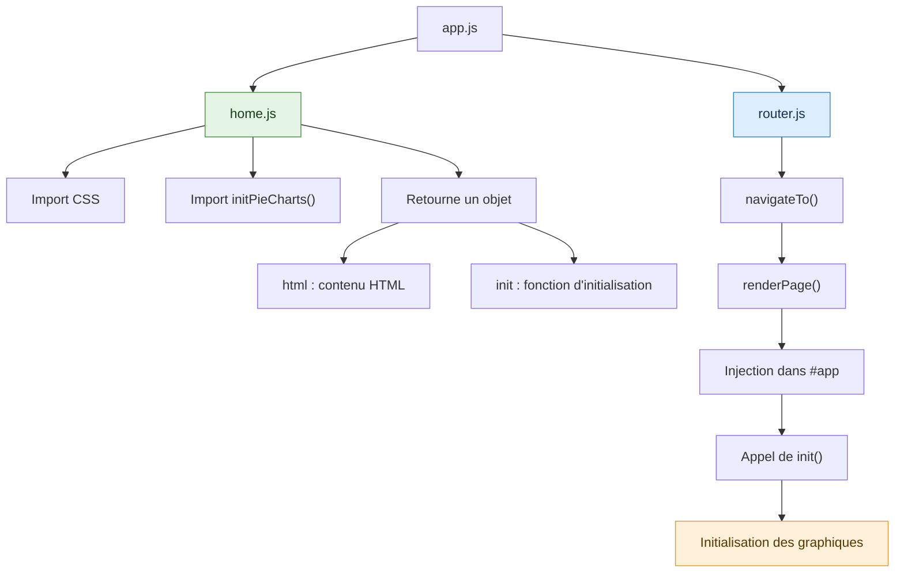

# Sandbox Vanilla

Retour au source avec HTML, CSS et JavaScript.

- Page Home: Ajout d'une galerie infinie de projets
- Page Statistique:
  - 3 pie-charts
  - 1 github-contribution-graph

## Architecture : pages modulaires et initialisation



### Le principe à retenir

| Élément         | Responsabilité                         |
| --------------- | -------------------------------------- |
| `app.js`        | Déclare les pages et lance le routeur  |
| `router.js`     | Gère la navigation et l'affichage      |
| `home.js`       | Fournit le HTML et ses initialisations |
| `pie-charts.js` | Contient la logique des graphiques     |


### Exemple de contrat entre une page et le routeur

```js
// home.js
export function home() {
  return {
    html: `<h1>Accueil</h1>`,
    init: initPieCharts
  };
}
```

Le routeur ne connaît que deux propriétés :
  - `html` : ce qu'il doit afficher.
  - `init` : ce qu'il doit exécuter après l'injection dans le DOM.

La règle d'or : une page est responsable de ses fonctionnalités. Le routeur est responsable de leur affichage, pas de leur fonctionnement interne.
